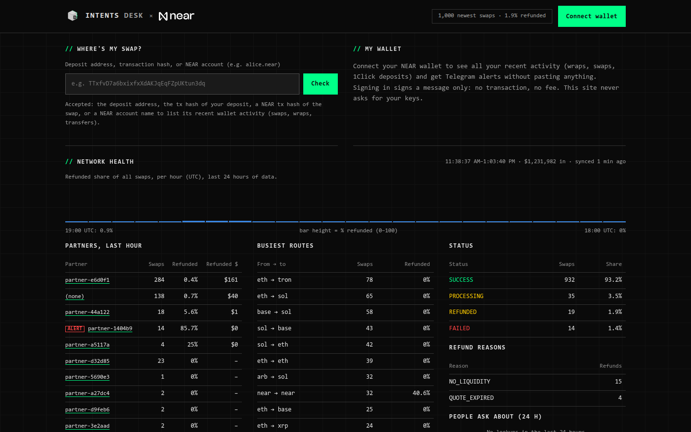
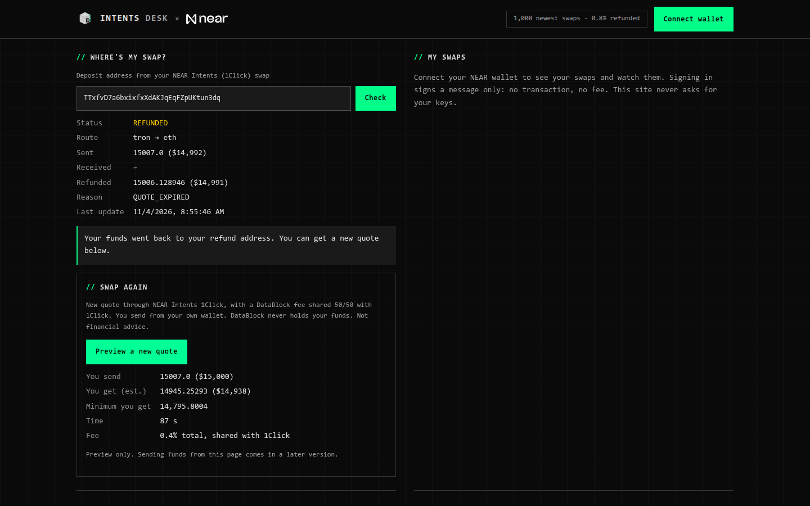
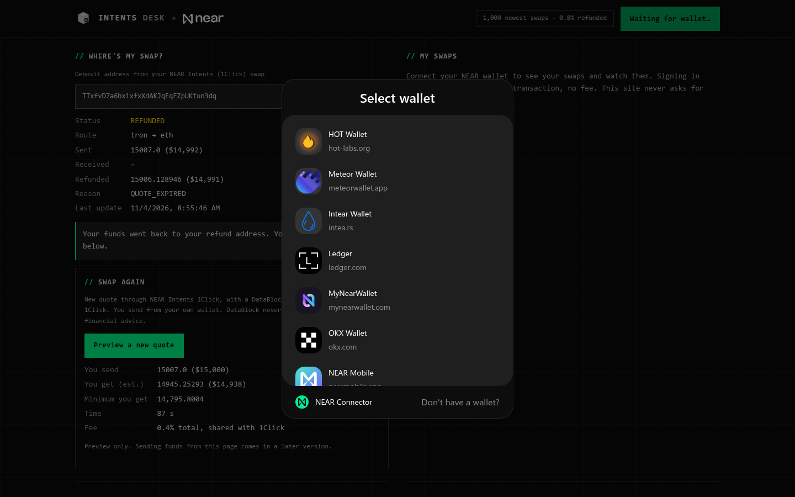
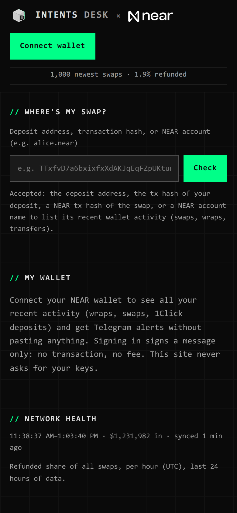
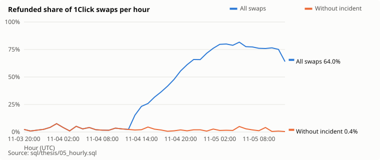
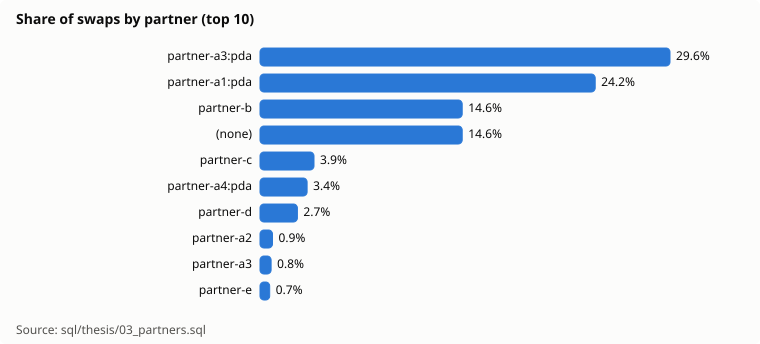
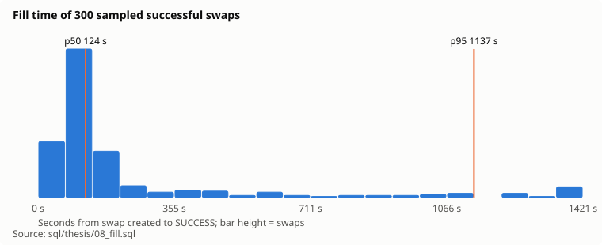
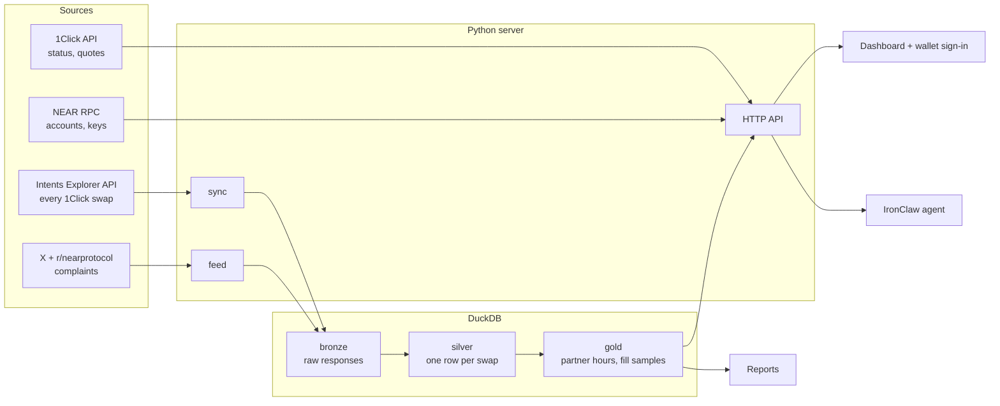

# Intents Desk

**A live reliability desk for NEAR Intents.** Check any 1Click swap, see which apps and routes
are failing right now, read what users report, and sign in with a NEAR wallet to watch your own
swaps. A NEAR × DataBlock product, built at NEAR HACKATHON (Nov 1–14, 2026).



**Watch the 2-minute explainer:** [docs/explainer.md](docs/explainer.md).

## The problem

NEAR Intents moves about $50M a day through its 1Click swap API. When a swap is stuck or
refunded, users get little help: r/nearprotocol and X are full of "my funds are stuck" and
"support is a void". Nobody publishes reliability numbers, so a failing integration can go
unnoticed for a day. On Nov 4–5, 2026, one widget integration sent 42,081 swaps and 95.5% of
them were refunded, while every other partner stayed near 2%. Intents Desk saw it in the first
hour.

## Try it (do this, see that)

**Live:** https://intents.datablock.pro (from Nov 8, 2026).

**Local:** needs Python 3.12+ and [uv](https://docs.astral.sh/uv/).

```sh
make test     # 60+ unit tests on recorded data; no keys needed
make serve    # then open http://localhost:8420
```

1. Open the page. You see **Network health**: refunded share per hour, partners with ALERT rows
   (at least 50 swaps and 50% refunded in the hour), the busiest routes and refund reasons.
   The live numbers need an Explorer API key (`INTENTS_EXPLORER_JWT`, see below); without one the
   page still runs and the swap lookup works.
2. Paste `TTxfvD7a6bxixfxXdAKJqEqFZpUKtun3dq` into **Where's my swap?** and press Check. You see
   REFUNDED, Tron → Ethereum, 15,006 USDT refunded, reason `QUOTE_EXPIRED`, what to do next, and
   a **Swap again** quote preview.
3. Press **Connect wallet** and pick any NEAR wallet. Your wallet signs a message (NEP-413): no
   transaction, no fee. You see your NEAR balance and **Wallet activity**: your recent
   transactions in plain words ("Wrapped 1 NEAR into wNEAR", "Sent 1.018 NEAR to 1Click swap
   308a38c6… SUCCESS"), with a NEARBlocks link for each. Nothing to paste.
4. Scroll to **What people report**: recent X and r/nearprotocol posts about stuck swaps,
   refunds and support, filterable.
5. For agents: `curl "localhost:8420/api/swap?address=TTxfvD7a6bxixfxXdAKJqEqFZpUKtun3dq&format=agent"`
   returns one line (about 140 bytes instead of 2.5 KB of JSON).
6. `make thesis DB=<database>` writes a dated report with charts; every number names its SQL file.

| Swap lookup | Wallet sign-in | Phone |
|---|---|---|
|  |  |  |

### Keys (all optional)

| Variable | What it unlocks |
|---|---|
| `INTENTS_EXPLORER_JWT` | Network health and the partner table (NEAR Intents Explorer API, partner dashboard) |
| `ONECLICK_JWT` | 1Click partner key: lower fees and the DataBlock fee on "Swap again" quotes |
| `X_BEARER_TOKEN` | X posts in the feed (Reddit works without it) |

Keys go in environment variables, never in the repository.

**Data retention.** 1Click API data (including Explorer swaps) is kept for at most 24 hours,
as the [1Click API terms](https://docs.near-intents.org/security-compliance/terms-of-service.md)
(§4.1(e)) require: the server deletes older rows after every sync. Reports keep only the
aggregate numbers derived from that window.

## What we found (Nov 3–5, 2026)

From 73,593 swaps and $74.0M over 40 hours (`reports/thesis-2026-11-05.md`):

- **$48.8M** came in through 1Click in the last 24 hours of data.
- **Without the incident, reliability is good:** the median hour refunds 2.0% of swaps.
- **One integration failed at scale:** 42,081 swaps from about 18 sender addresses, 95.5%
  refunded. 40,183 of the 40,184 `INTENT_SUBMIT_FAILED` refunds came from it. The refunded
  dollar total counts the same funds many times, because the senders retried.
- **Fill time:** the median successful swap settles in about 2 minutes; 95% within about 19.
- **Concentration:** the top 5 partners carry 75.5% of dollar volume.



| Share of swaps by partner | Fill time |
|---|---|
|  |  |

## Architecture



- **Sources.** Public NEAR data only: the Intents Explorer (every 1Click swap with its status),
  the 1Click API (one swap's status trail and quotes), NEAR RPC (accounts and access keys),
  FastNEAR's transactions API (one signed-in account's recent transactions), and community posts.
- **Storage.** One DuckDB file in three layers. Bronze keeps every raw response, so a parser fix
  never needs a re-fetch. Silver holds one row per swap; a swap's status changes after it is
  first seen, so rows are replaced by key, never appended. Gold holds the aggregates the page and
  reports read.
- **Server.** A small Python server with two background workers: one keeps swaps fresh within the
  Explorer's rate limit and catches up after downtime; one refreshes the community feed. Visitors
  never call a rate-limited API directly.
- **Page.** One page, no build step. Wallet connection uses NEAR Connect; sign-in is a NEP-413
  signed message that the server checks against the account's full-access keys on chain.
- **Agent.** An IronClaw skill (`agent/intents-desk/SKILL.md`) answers "where's my swap?" from
  the public 1Click API; the compact agent format keeps answers small.
- **Reports.** Every published number comes from a named SQL file and runs on a frozen snapshot,
  so the report can be rebuilt and checked.

**Design rules:** keep raw data; replace rows by key when status changes; one caller per
rate-limited API; numbers trace to queries; measure changes against a fixed benchmark before
keeping them.

## How it uses NEAR

- **NEAR Intents / 1Click:** the whole dataset is NEAR Intents swap activity; the swap lookup and
  "Swap again" quotes use the 1Click API.
- **NEAR accounts:** wallet sign-in with NEP-413 messages, verified against the account's
  full-access key over NEAR RPC. The app never holds keys or funds.
- **NEAR Connect:** the wallet picker (HOT, Meteor, Intear, MyNearWallet, Ledger, OKX, NEAR Mobile).
- **NEAR AI / IronClaw:** an agent skill, hosted on NEAR AI (staked with `datablock.near`).
- **Revenue on NEAR:** "Swap again" quotes carry a 0.40% app fee, split 50/50 with 1Click, paid to
  `datablock.near`.

## Hackathon tracks

| Track | What earns it |
|---|---|
| 02 Investment Thesis | The dated thesis report: volume, reliability, fill time, concentration, a check of public volume claims; every number from SQL |
| 08 Real-World Money | Swap reliability for real users: lookup, refund reasons, next steps, "Swap again" |
| 04 Autonomous Business / 07 Agent Economy | On-chain fee revenue to `datablock.near`; the IronClaw agent and its compact data format |
| 03 Privacy & Private AI | Agent hosted on NEAR AI's private inference; sign-in by signed message, no keys held |
| 06 AI Security & Defense | Signature-checked sign-in, CSRF and rate limits, strict CSP, a security review with tests for every fix |
| 13 Open Innovation | A public reliability layer for NEAR Intents |

## Security

- The server never holds private keys or funds. Users sign in by signing a message; "Swap again"
  only returns quotes, and deposits go from the user's own wallet.
- Sign-in nonces are single use and expire after 5 minutes; sessions are signed cookies
  (`HttpOnly`, `Secure`, `SameSite=Strict`).
- State-changing requests must come from the same origin; request size, time and rate are limited
  per client.
- Every page value is rendered as text; the Content-Security-Policy allows only the wallet
  library's hosts.
- API keys are sent only to their own API and never follow redirects.

## Built in the hackathon window, and disclosures

- All code in this repository was written from 2026-11-04 on, inside the hackathon window. There
  is no earlier baseline.
- Libraries: DuckDB, cryptography (ed25519), pytest, ruff, and `@hot-labs/near-connect` 0.12.0
  (vendored in `src/intents_desk/static/near-connect.js`).
- AI-assisted: much of the code was written with Claude Code and reviewed by a person.
- The NEAR logo (`src/intents_desk/static/near-logo.svg`) is NEAR's official reversed logo, saved
  unchanged from docs.near.org; the NEAR name and logo belong to NEAR. Design tokens come from
  DataBlock's design system (`static/tokens.css`). Rules: `design-system/intents-desk/MASTER.md`,
  checked by `make ui-check`.
- One project per submission; no other project is entered under this name.

## Partner view, recent swaps and Telegram alerts

- **Partner view** (`/#partner=<id>`, or click a partner): swaps and refund rate in the last
  24 h, refund % per hour, routes, refund reasons, status mix, and daily history from the
  aggregate tables. Public, aggregates only.
- **Recent swaps:** the newest 100 swaps, filterable by status, partner and route; click a
  deposit address to look the swap up.
- **Telegram alerts** (after wallet sign-in): press Connect Telegram, open the one-time link
  (10 minutes, single use) and press Start. The bot sends one message when a watched swap
  changes status (at most 20 watched swaps per account). **Auto-watch** (on by default once
  linked; one button turns it off): every 5 minutes the server reads each linked account's
  transactions, watches every new 1Click swap from the last 24 h, and sends one message with its
  status, so you never press Watch. In Telegram: `/status` lists your
  watched swaps, `/stop` unlinks. To enable on a server, create a bot with @BotFather and set
  `TELEGRAM_BOT_TOKEN` (`make serve` reads `~/.config/intents-desk/telegram.env`).

## Public tickets, Telegram reports and X

- **Public tickets:** a ticket is a support case someone chose to make public.
  - **Opened by:** "Report publicly" on a case; `/report <deposit address or tx hash>` in the Telegram bot; or automatically, when an X or Reddit post in the feed names a swap that 1Click knows.
  - **Shown in:** the Public tickets panel (`/api/tickets`), with status, reason, route and source. The deposit address stays on the server.
  - **Updated:** every 10 minutes, until the swap is final.
- **Telegram:**
  - The commands are `/report`, `/status`, `/stop` and `/help`; they show in the bot menu.
  - With `TELEGRAM_CHANNEL=@yourchannel` (the bot must be an admin there), new tickets, ticket status changes and incident open/close are posted to that public channel automatically. Partner names stay masked, with no addresses and at most 20 posts an hour.
- **X:**
  - The owner's Telegram gets each incident post, and each reply to an X post that named a swap, as a draft with buttons: Post ($0.015), Post + link ($0.20–0.215) and Skip.
  - Only a press from the owner's chat counts. Each draft is single use and expires after 24 h.
  - Posting runs `xurl --auth oauth1` and needs `X_POST=1` on the server; the keys stay in `~/.xurl`. Nothing is posted without a press.

## Custom alerts

- **Rules:** "tell me when …", checked every 10 minutes. Each one sends one message when it starts and one when it ends.
  - **Kinds:** a route's refund share (`route tron eth 20`), all swaps (`network 10`), refunds with one reason per hour (`reason QUOTE_EXPIRED 30`), a partner's incidents (`partner <id or alias>`), one large refund (`refund 5000`, owner only), or one swap (`swap <deposit address>`).
  - A route or network hour with fewer than 20 swaps never fires.
- **Telegram:** `/alert <rule>`, `/alert list` and `/alert off <n>`, from a linked chat. Users get their own alerts only, with at most 10 rules each.
- **Owner extras:** owner rules may add `+channel` (the public channel, aliases only) and `+x` (an X draft with Post/Skip buttons).
- **IronClaw:** the skill `agent/intents-desk-alerts/SKILL.md` turns a plain request into the same rule text and sends it to `POST /api/agent/alerts`.
  - The call carries `Authorization: Bearer <token>`. The server keeps only `AGENT_TOKEN_SHA256`.
  - The agent box sets `INTENTS_DESK_URL` and `INTENTS_DESK_TOKEN`.
- **Every alert has 4 lines, built from data:**
  1. what happened;
  2. how big;
  3. "Act": what users and which team should do;
  4. "Open": the link, plus how to stop the alert.

## Incident log

- **Rule:** an incident opens when a partner has at least 50 swaps in an hour and at least
  50% of them are REFUNDED or FAILED. For the whole network, the rule is more than 10% of all
  swaps. Bad hours with at most 2 clean hours between them are one incident. It closes after
  2 clean hours.
- **Data:** detection reads the hourly rollup (`ops.hourly_swap_summary`, kept forever) and
  the newest raw hours. It runs after every sync, and every 2 minutes while an incident is
  open. `ops.incident` keeps totals, routes and per-hour rates, plus a sample of public NEAR
  transaction hashes as evidence. It never keeps sender, recipient or full deposit addresses.
- **Page:** **Past incidents** lists every incident. Click one for the hourly rates, routes
  and evidence (`/#incident=<id>`). Hours with no swaps at all show as data gaps.
- **Posts:** each incident gets a report in `reports/incidents/` (git-ignored), and a vault
  note when `VAULT_INCIDENTS_DIR` is set. The owner (`OWNER_ACCOUNT`, linked in Telegram) gets
  one X draft when an incident opens and one when it closes. Nothing is posted automatically.
- **After the 24 h purge:** `intents-desk incidents --evidence <id>` fetches the incident's
  swaps again from the Explorer API (referral filter, about 4 minutes for 44,000 swaps).
  It adds the senders count and the evidence sample.
- **Stale data:** if no sync has worked for 30 minutes, the owner gets one Telegram message.
- **Always on:** `make service` installs a systemd user service (`Restart=always`) that runs
  `scripts/serve-live` with the env files in `~/.config/intents-desk/`.

## Support cases and engineer reports

- **Where's my swap?** accepts a deposit address, the tx hash of the deposit, or a NEAR tx hash.
  A hash is looked up with the Explorer API `search` (one search every 5 s per server).
- **Case file:** it shows the answer in one sentence, why it happened (each refund reason
  has a plain explanation), the next step, and the incident that the swap is part of.
  It also shows a timeline and every transaction with its chain, NEAR block height and
  explorer link.
- **Share it:** **Copy link** (`/#case=<ref>`), **Copy support message** (paste it into a
  support chat) and **Download .md**. None of them include a recipient or refund address.
- **Storage:** the case is saved in `app.support_case` in our own database (the Hetzner server,
  backed up daily). It keeps only public chain data and the facts of the case, so a case link
  still works after 1Click's 24 h. Block heights are cached in `app.tx_block`.
- **Support data:** `ops.support_lookup` counts lookups per hour by status, reason and route,
  with no address. **People ask about (24 h)** shows them under Network health. When one
  reason gets 10 lookups in an hour, the owner gets one Telegram message.
- **Engineer report:** every incident (page, `reports/incidents/`, vault note) lists:
  - the NEAR block range;
  - who should look (wallet or widget team, solvers, 1Click);
  - sample swaps with the NEAR tx, block, origin tx and intent hash;
  - two charts (swaps per hour, bad % per hour);
  - a **Reproduce** block with the curl commands that fetch the same data again.
  The page also offers the evidence as CSV and the incident as JSON.

## Swaps, recovery and fees

- **New swap** (after wallet sign-in): NEAR ↔ USDC on NEAR, paid to your own account, with
  refunds back to it. Press **Send from your wallet** and your wallet asks you to approve
  one transfer to the 1Click deposit address. The page takes the address and amount from
  the quote, and the server never holds keys or funds.
- **Recover a refund at today's price:** look up a refunded swap whose refund came back to
  your NEAR account. The page shows then-versus-today and re-runs the swap to the same
  recipient, sent from your wallet.
- **Fee:** 0.40% of what you send, split 50/50 with 1Click (0.20% to `datablock.near`). Every
  quote carries `referral=intents-desk`, so the Intents Explorer can count our swaps.
- **Limits while testing:** $25 per swap (`SWAP_MAX_USD`). Live deposit addresses need
  `SWAP_LIVE=1`.
- **Revenue:** every 5 minutes the server settles its own quotes (`app.quote`). On SUCCESS
  it records our share of the fee in USD; `ops.daily_revenue` sums it per day.
  `uv run intents-desk revenue` prints the totals and checks them against the Explorer.
  `uv run intents-desk fees` shows where the fees land (the wallet, or a balance inside
  `intents.near`).
- **Solver budget rule:** the solver lab may only risk what Intents Desk has earned (the
  `revenue` total). Nothing moves on its own; a person signs every transfer.

## Operations audit

Every job (sync, feed, fetch, rollup, thesis, backup) writes a row to `ops.run_log`: start,
end, status, rows, error and code version. Before raw 1Click data is purged at 24 hours, each
complete and settled hour is rolled up into `ops.hourly_swap_summary` (partner, route,
status, swaps, USD); `ops.daily_swap_summary` sums the hours. An hour is written once and
never replaced, so a later partial source cannot shrink it.

```sh
make audit DB=<database>        # recent runs
make backup DB=<database>       # Parquet backup + manifest (row counts, SHA-256), then verified
uv run intents-desk verify-backup data/backups/intents-desk/<stamp>
uv run intents-desk rollup --from-db <old.duckdb>   # aggregates from an older database
```

**Automatic backups.** Start the server with `BACKUP_DIR` (local folder) and/or `BACKUP_PUSH`
(`host:/absolute/path`, e.g. the NAS) and it backs up once a day: Parquet + manifest, verified
locally, copied over SSH, then every file's SHA-256 is checked again on the remote side. Each
run is a row in `ops.run_log` (job `backup`). By hand: `uv run intents-desk backup --push host:/path`.

The module is product-neutral (`src/intents_desk/ops.py`): other DataBlock products can use
the same tables. Backups never contain raw 1Click/Explorer data (API terms §4.1(e)).

## Development

```sh
make test          # unit tests
make ui-check      # design rules on the page (exit 1 on a violation)
scripts/premerge fast   # what runs before every push (lint, format, tests, ui-check)
```

Deploy files: `Dockerfile` and `fly.toml` (Fly.io; the database lives on a volume).

## License

[PolyForm Noncommercial 1.0.0](LICENSE). You may read, run and change this code for
noncommercial purposes, including judging and research. Commercial use needs a license from
DataBlock LLC: https://datablock.pro/contact

Copyright DataBlock LLC.
