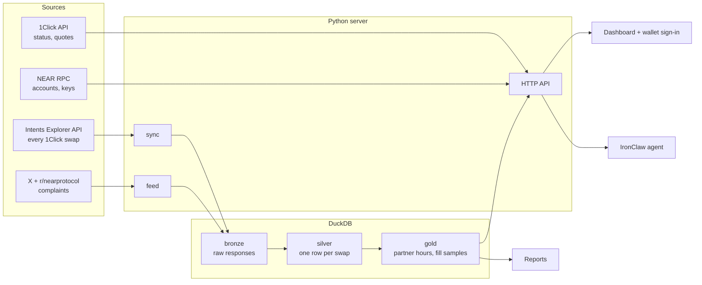

# Intents Desk

**A live reliability desk for NEAR Intents.** Check any 1Click swap, see which apps and routes
are failing right now, read what users report, and sign in with a NEAR wallet to watch your own
swaps. A NEAR × DataBlock product, built at NEAR HACKATHON (Nov 1–14, 2026).


## The problem

NEAR Intents moves about $50M a day through its 1Click swap API. When a swap is stuck or
refunded, users get little help: r/nearprotocol and X are full of "my funds are stuck" and
"support is a void". Nobody publishes reliability numbers, so a failing integration can go
unnoticed for a day. On Nov 4–5, 2026, one widget integration sent 42,081 swaps and 95.5% of
them were refunded, while every other partner stayed near 2%. Intents Desk saw it in the first
hour.

## Try it (do this, see that)

**Live:** https://intents.datablock.pro (from Nov 8, 2026).

**Local:** needs Python 3.12+ and [uv](https://docs.astral.sh/uv/).

```sh
make test     # 60+ unit tests on recorded data; no keys needed
make serve    # then open http://localhost:8420
```

1. Open the page. You see **Network health**: refunded share per hour, partners with ALERT rows
   (at least 50 swaps and 50% refunded in the hour), the busiest routes and refund reasons.
   The live numbers need an Explorer API key (`INTENTS_EXPLORER_JWT`, see below); without one the
   page still runs and the swap lookup works.
2. Paste `TTxfvD7a6bxixfxXdAKJqEqFZpUKtun3dq` into **Where's my swap?** and press Check. You see
   REFUNDED, Tron → Ethereum, 15,006 USDT refunded, reason `QUOTE_EXPIRED`, what to do next, and
   a **Swap again** quote preview.
3. Press **Connect wallet** and pick any NEAR wallet. Your wallet signs a message (NEP-413): no
   transaction, no fee. You see your NEAR balance, swaps sent or refunded to your account, and
   you can watch a swap.
4. Scroll to **What people report**: recent X and r/nearprotocol posts about stuck swaps,
   refunds and support, filterable.
5. For agents: `curl "localhost:8420/api/swap?address=TTxfvD7a6bxixfxXdAKJqEqFZpUKtun3dq&format=agent"`
   returns one line (about 140 bytes instead of 2.5 KB of JSON).
6. `make thesis DB=<database>` writes a dated report with charts; every number names its SQL file.

| Swap lookup | Wallet sign-in | Phone |
|---|---|---|
|  |  |  |


### Keys (all optional)

| Variable | What it unlocks |
|---|---|
| `INTENTS_EXPLORER_JWT` | Network health and the partner table (NEAR Intents Explorer API, partner dashboard) |
| `ONECLICK_JWT` | 1Click partner key: lower fees and the DataBlock fee on "Swap again" quotes |
| `X_BEARER_TOKEN` | X posts in the feed (Reddit works without it) |

Keys go in environment variables, never in the repository.

## What we found (Nov 3–5, 2026)

From 73,593 swaps and $74.0M over 40 hours (`reports/thesis-2026-11-05.md`):

- **$48.8M** came in through 1Click in the last 24 hours of data.
- **Without the incident, reliability is good:** the median hour refunds 2.0% of swaps.
- **One integration failed at scale:** 42,081 swaps from about 18 sender addresses, 95.5%
  refunded. 40,183 of the 40,184 `INTENT_SUBMIT_FAILED` refunds came from it. The refunded
  dollar total counts the same funds many times, because the senders retried.
- **Fill time:** the median successful swap settles in about 2 minutes; 95% within about 19.
- **Concentration:** the top 5 partners carry 75.5% of dollar volume.


| Share of swaps by partner | Fill time |
|---|---|
|  |  |

## Architecture



- **Sources.** Public NEAR data only: the Intents Explorer (every 1Click swap with its status),
  the 1Click API (one swap's status trail and quotes), NEAR RPC (accounts and access keys), and
  community posts.
- **Storage.** One DuckDB file in three layers. Bronze keeps every raw response, so a parser fix
  never needs a re-fetch. Silver holds one row per swap; a swap's status changes after it is
  first seen, so rows are replaced by key, never appended. Gold holds the aggregates the page and
  reports read.
- **Server.** A small Python server with two background workers: one keeps swaps fresh within the
  Explorer's rate limit and catches up after downtime; one refreshes the community feed. Visitors
  never call a rate-limited API directly.
- **Page.** One page, no build step. Wallet connection uses NEAR Connect; sign-in is a NEP-413
  signed message that the server checks against the account's full-access keys on chain.
- **Agent.** An IronClaw skill (`agent/intents-desk/SKILL.md`) answers "where's my swap?" from
  the public 1Click API; the compact agent format keeps answers small.
- **Reports.** Every published number comes from a named SQL file and runs on a frozen snapshot,
  so the report can be rebuilt and checked.

**Design rules:** keep raw data; replace rows by key when status changes; one caller per
rate-limited API; numbers trace to queries; measure changes against a fixed benchmark before
keeping them.

## How it uses NEAR

- **NEAR Intents / 1Click:** the whole dataset is NEAR Intents swap activity; the swap lookup and
  "Swap again" quotes use the 1Click API.
- **NEAR accounts:** wallet sign-in with NEP-413 messages, verified against the account's
  full-access key over NEAR RPC. The app never holds keys or funds.
- **NEAR Connect:** the wallet picker (HOT, Meteor, Intear, MyNearWallet, Ledger, OKX, NEAR Mobile).
- **NEAR AI / IronClaw:** an agent skill, hosted on NEAR AI (staked with `datablock.near`).
- **Revenue on NEAR:** "Swap again" quotes carry a 0.40% app fee, split 50/50 with 1Click, paid to
  `datablock.near`.

## Hackathon tracks

| Track | What earns it |
|---|---|
| 02 Investment Thesis | The dated thesis report: volume, reliability, fill time, concentration, a check of public volume claims; every number from SQL |
| 08 Real-World Money | Swap reliability for real users: lookup, refund reasons, next steps, "Swap again" |
| 04 Autonomous Business / 07 Agent Economy | On-chain fee revenue to `datablock.near`; the IronClaw agent and its compact data format |
| 03 Privacy & Private AI | Agent hosted on NEAR AI's private inference; sign-in by signed message, no keys held |
| 06 AI Security & Defense | Signature-checked sign-in, CSRF and rate limits, strict CSP, a security review with tests for every fix |
| 13 Open Innovation | A public reliability layer for NEAR Intents |

## Security

- The server never holds private keys or funds. Users sign in by signing a message; "Swap again"
  only returns quotes, and deposits go from the user's own wallet.
- Sign-in nonces are single use and expire after 5 minutes; sessions are signed cookies
  (`HttpOnly`, `Secure`, `SameSite=Strict`).
- State-changing requests must come from the same origin; request size, time and rate are limited
  per client.
- Every page value is rendered as text; the Content-Security-Policy allows only the wallet
  library's hosts.
- API keys are sent only to their own API and never follow redirects.

## Built in the hackathon window, and disclosures

- All code in this repository was written from 2026-11-04 on, inside the hackathon window. There
  is no earlier baseline.
- Libraries: DuckDB, cryptography (ed25519), pytest, ruff, and `@hot-labs/near-connect` 0.12.0
  (vendored in `src/intents_desk/static/near-connect.js`).
- AI-assisted: much of the code was written with Claude Code and reviewed by a person.
- The NEAR logo (`src/intents_desk/static/near-logo.svg`) is NEAR's official reversed logo, saved
  unchanged from docs.near.org; the NEAR name and logo belong to NEAR. Design tokens come from
  DataBlock's design system (`static/tokens.css`). Rules: `design-system/intents-desk/MASTER.md`,
  checked by `make ui-check`.
- One project per submission; no other project is entered under this name.

## Development

```sh
make test          # unit tests
make ui-check      # design rules on the page (exit 1 on a violation)
scripts/premerge fast   # what runs before every push (lint, format, tests, ui-check)
```

Deploy files: `Dockerfile` and `fly.toml` (Fly.io; the database lives on a volume).

## License

[PolyForm Noncommercial 1.0.0](LICENSE). You may read, run and change this code for
noncommercial purposes, including judging and research. Commercial use needs a license from
DataBlock LLC: https://datablock.pro/contact

Copyright DataBlock LLC.
