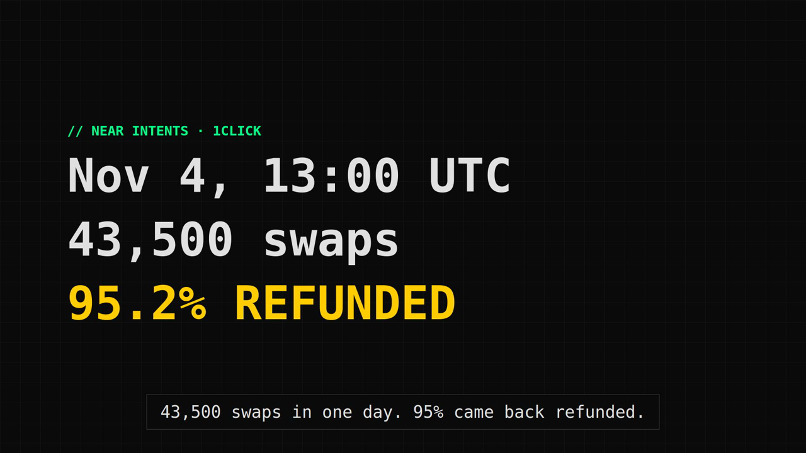
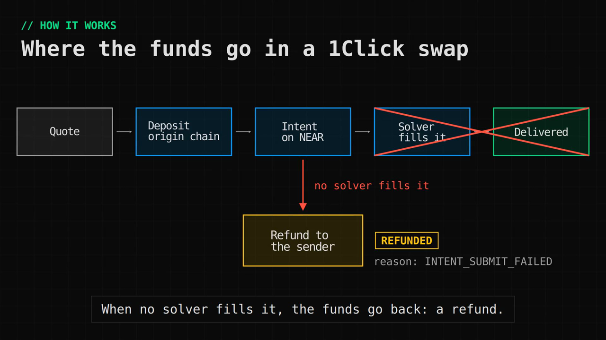
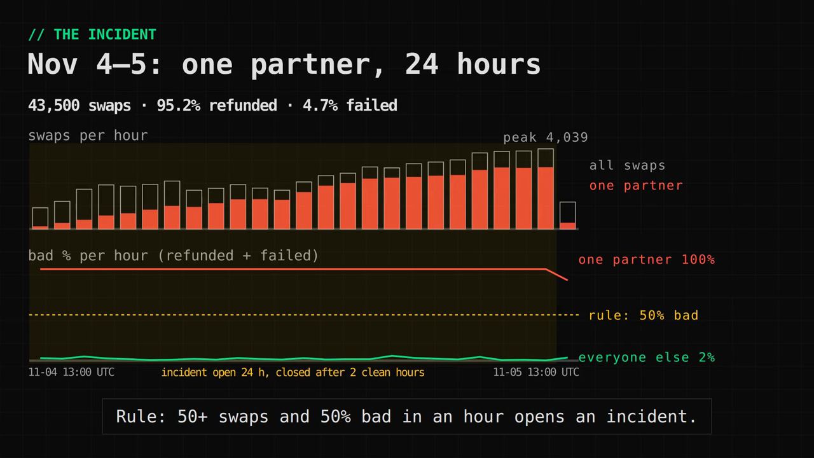
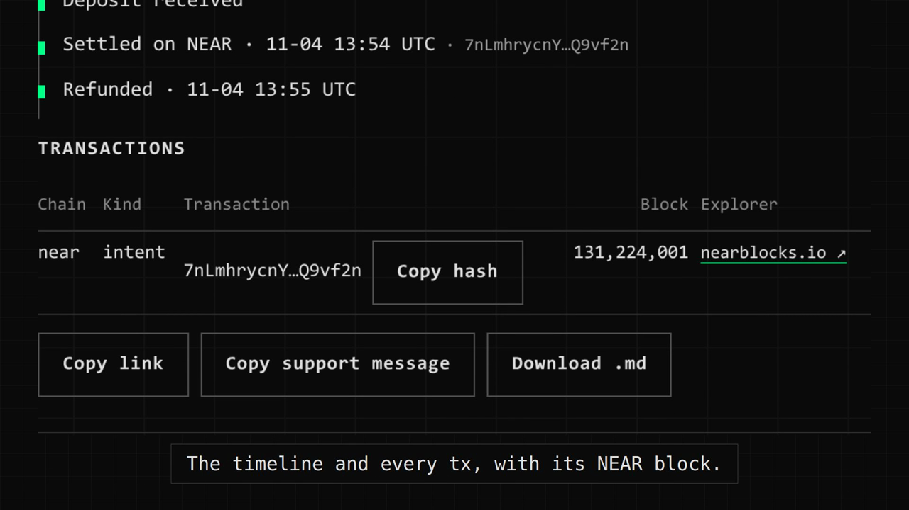
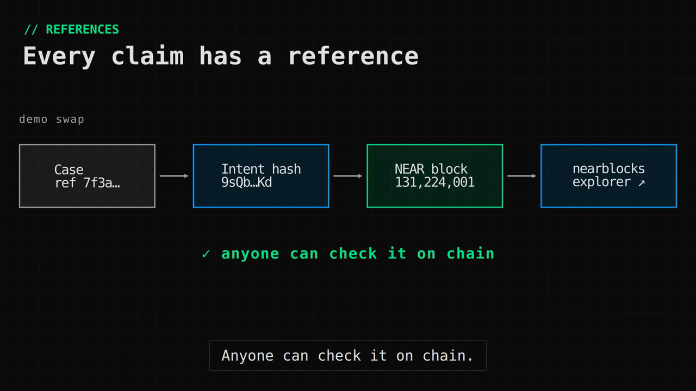
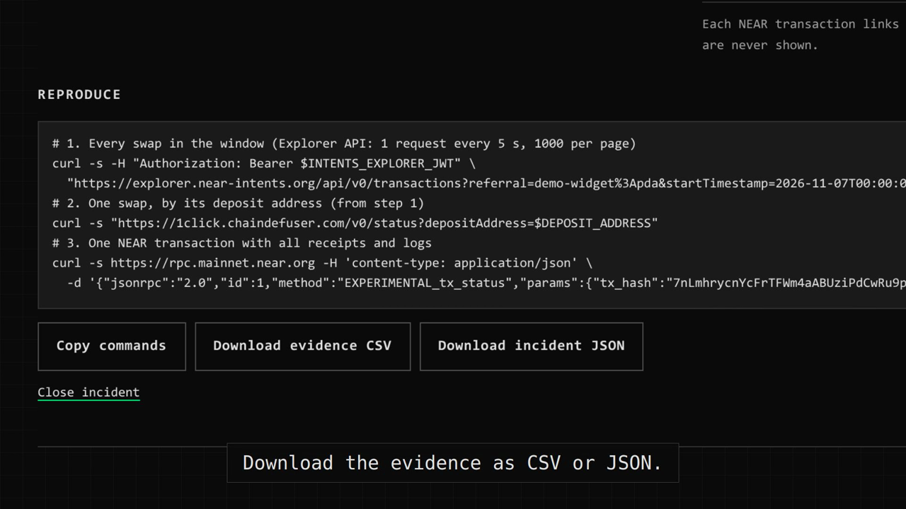

# Intents Desk in 2 minutes

**Watch:** [explainer.mp4](video/explainer.mp4) (2 min, captions in the video, 4 MB). Captions file: [explainer.srt](video/explainer.srt).

## The problem

NEAR Intents 1Click swaps move funds between chains. When a swap is refunded, the user gets one
word: *refunded*. They do not get the reason, the transactions or the time. Support gets a
screenshot and a "where are my funds?" message.

On **Nov 4, 2026 at 13:00 UTC**, one partner's swaps started to fail. In 25 hours,
**43,500 swaps** went through its three referral ids, and **95.2% were refunded**; another 4.7%
failed before any funds moved. Every other partner stayed near 2%.

## How a 1Click swap works

1. **Quote:** 1Click gives a price, a deposit address and a deadline.
2. **Deposit:** the user sends funds on the origin chain.
3. **Intent:** 1Click puts the swap on NEAR as an intent.
4. **Fill:** a solver fills the intent and the funds go to the recipient.

When no solver fills the intent, the funds go back to the refund address. The reason code tells
why, for example `INTENT_SUBMIT_FAILED` or `QUOTE_EXPIRED`.

## The incident, hour by hour

Intents Desk counts every swap, every hour, for each partner (the referral id).

- **Rule:** an incident opens when a partner has at least 50 swaps and 50% refunded or failed
  in an hour.
- **Network rule:** an incident also opens when more than 10% of all swaps are bad.
- **End:** an incident closes after 2 clean hours.

The two charts use one axis each: swaps per hour, then bad % per hour. The partner name is
masked here, as on the public page, until the partner has been told.

## Where's my swap?

Paste a deposit address, the tx hash of the deposit, or a NEAR tx hash. The case file shows:

- **The answer first:** "Your funds came back: 15006.128946 to your refund address."
- **Why it happened and the next step**, from a fixed table of reason codes.
- **A timeline:** quote, deposit, settled on NEAR, refunded or delivered.
- **Every transaction**, with its NEAR block height and an explorer link.
- **Copy support message:** plain text for a support chat. It has no addresses.

A lookup by tx hash shows less than a lookup by address. A tx hash can be public, so the view
leaves out every transaction that shows an address.

## Every claim has a reference

Each number links to a public record: case → intent hash → NEAR block → nearblocks. Anyone can
check it on chain.

## The engineer report

Each incident gets a report for the teams who can fix it:

- **Who should look:** the wallet or widget team, 1Click / NEAR Intents, or the solvers.
- **The NEAR block range** of the evidence, so an engineer can replay it on an archival node.
- **Evidence:** sample swaps with status, reason, route, NEAR tx and block.
- **Reproduce:** `curl` commands for the Explorer API, the 1Click status API and the NEAR RPC.
  Keys are placeholders such as `$INTENTS_EXPLORER_JWT`.
- **Downloads:** the evidence as CSV, and the incident as JSON.

The same report goes to `reports/incidents/*.md` and, as a draft, to the owner's Telegram.

## Try it

- **Live:** https://intents.datablock.pro (from Nov 8, 2026).
- **Run it locally:** see [Try it](../README.md#try-it-do-this-see-that) in the README.
- **The code:** support cases are in `src/intents_desk/support.py`; incidents are in `src/intents_desk/incidents.py`.

## How the video is made

The video is code, in [`video/`](../video/README.md):

- **Manim** draws the concept scenes from `video/data/incident.json`. That file is a masked export of the incident log.
- **Playwright** takes the app screenshots, using demo data from `tests/fakes.py`.
- **Remotion** puts the scenes, the screenshots and the captions together.

The numbers in the video come from the incident log's hourly counts (13:00 Nov 4 to 14:00 Nov 5
UTC). The [Nov 5 report](../reports/thesis-2026-11-05.md) used a raw sample with a different
window, so its numbers are a little different.
