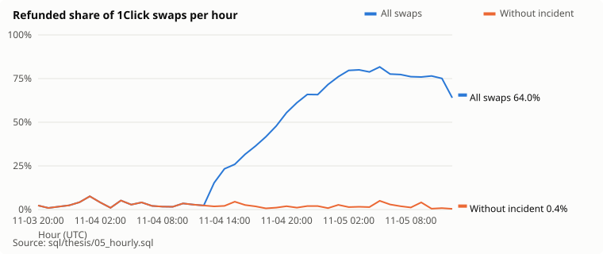
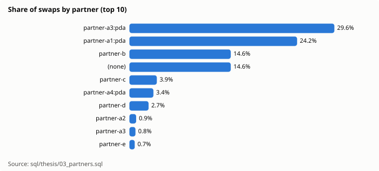
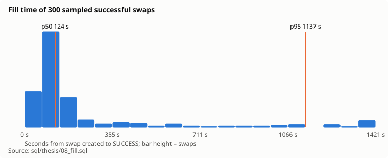

# NEAR Intents (1Click): volume, reliability and one incident

Report date: 2026-11-05. Data window: 2026-11-03 20:56 UTC to 2026-11-05 12:42 UTC (39.8 h), 73,593 swaps,
$74,009,639 in. Built by Intents Desk (DataBlock) for NEAR HACKATHON. Every number
comes from a SQL file in `sql/thesis/`; run `make thesis` to rebuild this report.

## Summary

- **Volume:** $48,754,184 came in through 1Click in the last 24 hours of data
  (62,415 swaps). Source: `09_last24h.sql`.
- **Reliability without the incident is good:** the median hour refunds 2.0% of
  swaps when the incident partners are left out. Source: `05_hourly.sql`.
- **One partner type failed at scale:** 3 wallet-widget referral ids of one partner that end in
  `:pda` sent 42,081 swaps; 95.5% were refunded ($3,620,958 counted
  across retries, so the same funds appear many times). Source:
  `07_incident.sql`.
- **Fill time:** the median successful swap settles in 124 s; 95% settle within
  1,137 s (sample of 300). Source: `08_fill.sql`.
- **Concentration:** the top 5 partners carry 75.5% of USD volume (HHI 1,882
  of 10,000). Source: `04_concentration.sql`.

## 1. Reliability

The blue line is all swaps. The orange line removes the incident partners. The gap
between them is the incident. Hours with data: 41.

| reason | refunds | refunds_without_incident | usd |
|---|---|---|---|
| INTENT_SUBMIT_FAILED | 40,184 | 1 | 3,620,972.0 |
| QUOTE_EXPIRED | 479 | 479 | 1,935,892.0 |
| NO_LIQUIDITY | 212 | 212 | 29.0 |
| AMOUNT_MORE_THAN_BALANCE | 20 | 20 | 146,383.0 |
| UNKNOWN | 3 | 3 | 19,396.0 |
| AMOUNT_LESS_THAN_MIN_WITHDRAWABLE | 1 | 1 | 10.0 |
| PARTIAL_DEPOSIT | 1 | 1 | 6.0 |

Source: `06_reasons.sql`.

## 2. The `:pda` incident

| referral | first_seen | last_seen | swaps | refund_pct | refunded_usd | senders | top_reason |
|---|---|---|---|---|---|---|---|
| partner-a3:pda | 2026-11-04 13:05 UTC | 2026-11-05 12:42 UTC | 21,800 | 94.9 | 1,379,788.0 | 18 | INTENT_SUBMIT_FAILED |
| partner-a1:pda | 2026-11-04 13:51 UTC | 2026-11-05 12:42 UTC | 17,797 | 96.3 | 2,177,668.0 | 18 | INTENT_SUBMIT_FAILED |
| partner-a4:pda | 2026-11-04 22:54 UTC | 2026-11-05 12:42 UTC | 2,484 | 94.8 | 63,502.0 | 3 | INTENT_SUBMIT_FAILED |

Source: `07_incident.sql`. Few sender addresses and a very high swap count suggest an
integration or a bot that retries. Most refunds are `INTENT_SUBMIT_FAILED`: in this window,
40183
of the 40,184 refunds with that reason came from the incident partners.
Because the same senders retry, the refunded USD counts the same funds many times; it
is not money lost. Refunds return the funds; the cost is failed swaps, fees and time.

## 3. Volume and partners

| partner | swaps | swap_share_pct | usd_in | refund_pct |
|---|---|---|---|---|
| partner-a3:pda | 21,800 | 29.6 | 1,437,597.0 | 94.9 |
| partner-a1:pda | 17,797 | 24.2 | 2,287,166.0 | 96.3 |
| partner-b | 10,741 | 14.6 | 26,327,076.0 | 0.8 |
| (none) | 10,725 | 14.6 | 15,188,014.0 | 3.1 |
| partner-c | 2,900 | 3.9 | 7,953,196.0 | 0.9 |
| partner-a4:pda | 2,484 | 3.4 | 67,288.0 | 94.8 |
| partner-d | 1,985 | 2.7 | 2,872,040.0 | 0.8 |
| partner-a2 | 657 | 0.9 | 34,959.0 | 0.3 |
| partner-a3 | 612 | 0.8 | 294,184.0 | 0.0 |
| partner-e | 536 | 0.7 | 3,530,967.0 | 0.7 |

Source: `03_partners.sql`.

| origin_chain | swaps | usd_in | usd_share_pct |
|---|---|---|---|
| eth | 19,911 | 24,234,977.0 | 32.7 |
| tron | 7,555 | 11,745,757.0 | 15.9 |
| btc | 2,554 | 8,798,584.0 | 11.9 |
| hot-omni | 13,170 | 7,964,219.0 | 10.8 |
| zec | 943 | 7,567,255.0 | 10.2 |
| sol | 7,209 | 5,202,804.0 | 7.0 |
| near | 2,425 | 3,672,217.0 | 5.0 |
| base | 4,499 | 1,738,078.0 | 2.3 |
| arb | 12,511 | 910,949.0 | 1.2 |
| xrp | 489 | 880,512.0 | 1.2 |

Source: `02_by_chain.sql`.

| top5_usd_share_pct | hhi_usd | partners |
|---|---|---|
| 75.5 | 1,882.0 | 148 |

Source: `04_concentration.sql`.

## 4. Fill time

| sampled | p50 (s) | p95 (s) | max (s) |
|---|---|---|---|
| 300 | 124.0 | 1137.0 | 4647.0 |

Method: a fixed pseudo-random sample of SUCCESS swaps older than 1 hour. Fill time =
1Click status `updatedAt` minus Explorer `createdAt`. `updatedAt` is the last status
change, so this is an upper bound on the real settlement time.

## 5. Claim check

Public figures say more than $30B cumulative and about $4B a month. Our window shows
$48,754,184 in 24 hours, about $1.5B a month at that rate.

What this window can show: 1Click swaps only, for 39.8 hours. What it cannot show:
volume outside 1Click (direct `intents.near` use by solvers and apps), earlier months, or
private-shard swaps. A gap between the two figures is expected; it is not evidence
that the public figure is wrong.

## Method and limits

- Source: NEAR Intents Explorer API (every 1Click swap, with status and USD values),
  1Click status API (for fill times). Raw responses are kept in `bronze.explorer_tx`.
- A swap is counted once (keyed by deposit address and memo); a status change replaces
  the row.
- The window is short (39.8 h). Hourly rates in hours with few swaps are noisy.
- Not financial advice.
